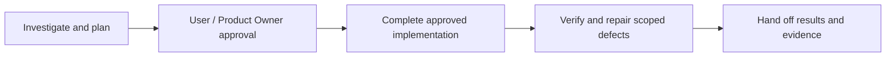

# Agent Kit

Shared instructions, technical skills, and optional agents for **Codex and Claude Code**—with explicit planning, approval, and verification.

Use Agent Kit to establish a consistent way of working in a new project or an existing codebase. It provides guidance for AI-assisted software development while preserving your project's business rules, stack, contracts, and permissions.

**Status:** 0.1.0 preview. Source/package evidence is recorded in [verification results](docs/verification-results.md). Native discovery, effective model/permissions, workflow behavior, and two-machine compatibility remain **NOT_RUN** unless a specific observation is recorded.

## What's included

| Component | Purpose |
| --- | --- |
| [Shared instructions](AGENTS.md) | A lean operating core for planning, approval, implementation, and handoff. [CLAUDE.md](CLAUDE.md) imports the same instructions. |
| [17 technical skills](docs/skills-catalog.md) | Focused guidance for requirements, implementation, debugging, testing, security, performance, documentation, and more. Skills are mirrored byte for byte in `.claude/skills/`. |
| [Three optional Codex agents](.codex/agents/) | Explorer, implementer, and reviewer definitions for bounded assignments when delegation is authorized and useful. |
| [Project records](docs/tasks/README.md) | Context, plan, state, and task templates for keeping decisions and evidence available across sessions. |
| [TechNote](docs/technote.md) | A four-level method for explaining technical results through text, diagrams, interactive websites, or video, subject to available tools. |

The main session owns delivery. A separate coordinator, supervisor, or multi-agent team is not required.

## Quick start

1. Use this repository as a template for a new project, or review the relevant parts before integrating them into an existing codebase.
2. Open the project root in Codex or Claude Code and describe the outcome you need.
3. Review the proposed plan and explicitly approve it before implementation, including small fixes.
4. Let the owner complete the approved work, run relevant checks, and hand off the result with evidence and remaining limits.

Choose a starting prompt below and replace bracketed inputs with your project details.

### Start a new project

```text
Use https://github.com/khiemnd777/agent-kit as the template for a new project.

Project name: [name]
Goal: [observable outcome]
Target users: [users]

Inspect the template. Propose scope, stack, ownership and acceptance in chat.
Wait for my approval before writing files or executing the setup.
After approval, initialize the project with fresh records and the single
team workflow. Establish a running app and basic check before broadening.
Do not import approvals from the template or build a comprehensive harness.
```

### Integrate into an existing codebase

```text
Use https://github.com/khiemnd777/agent-kit to integrate Agent Kit into this existing codebase.

Inspect current project instructions, skills, code and verified commands.
Preserve actual business rules, existing records and other developers' work.
Propose a bounded integration plan in chat and wait for my approval.
After approval, apply one delivery workflow and verify relevant package/
content consistency. Do not duplicate trackers or change global settings.
```

## How work flows



Every task requires plan approval. Small tasks can use a short chat plan; they do not require a new task file or extra agent. Approved scope covers local edits, focused checks, and routine repairs. Material scope changes require renewed approval.

For long, complex, or UI tasks, complete all approved production code and real wiring before writing/updating and running tests. Complex tasks first evaluate risks and alternatives. UI tasks first present an ASCII mockup for approval. Missing decisions or authority pause the affected work; independent authorized work can continue.

Select only the skills needed for the task. Report actual skill contributions and save phase records in the [local skill journal](docs/engineering/skill-usage/README.md) within authorized write scope. Estimates are not measured time, token savings, or effectiveness scores.

See [team workflow](docs/team-workflow.md) for delivery details, [failure handling](docs/team-workflow.md#failures-and-blockers) for blocked checks, and [team policy](docs/team-policy.md) for authority and safety boundaries.

## Keep project context available

Keep durable rules in `AGENTS.md`, stable design in [project context](docs/project-context.md), intended outcomes in [project plan](docs/project-plan.md), and one current summary in [project state](docs/project-state.md). Use task records and checkpoints when useful or required, especially for long or resumed work.

Assign one writer to shared records and update affected entries during authorized work. New projects start with fresh records; template history grants no project approval or product acceptance.

For multiple developers, agree on contracts and separate ownership. Codex and Claude Code do not share live chat or locks. Continue from source and project records through the authorized communication path. See [task field guides](docs/agent-coordination-templates.md) and [role responsibilities](docs/roles/coordinator.md).

## Compatibility and limits

- The kit supplies source instructions and definitions. See [compatibility notes](docs/agent-compatibility.md) and the [verification guide](docs/verification-guide.md) for the distinction between package checks and observed client behavior. The [Codex pilot](docs/codex-pilot-handoff.md) remains **NOT_RUN**.
- [Model routing](docs/model-routing.md) inherits the developer's selection by default. Optional agents retain parent/runtime and task limits; role descriptions do not enforce sandbox or tool profiles.
- No application dependencies, credentials, hooks, automatic installers, services, global settings, or test harness are bundled. TechNote presentation tools are separate capabilities.
- A completed source change does not establish verified runtime behavior, human acceptance, or release. Git publication, deployment, production/data operations, paid actions, and destructive actions require their actual authority.

## Contributing and license

See [CONTRIBUTING.md](CONTRIBUTING.md) and the [MIT license](LICENSE).

Sixteen engineering skills and selected references derive from the pinned [Addy Osmani source](https://github.com/addyosmani/agent-skills/tree/1401c8b8030e023baeebb31781a6653fe8e93026). Approved adaptations retain origin metadata and the upstream MIT notice in [.agents/ADDY-AGENT-SKILLS-LICENSE](.agents/ADDY-AGENT-SKILLS-LICENSE) and its Claude mirror. See [skill provenance](docs/skills-provenance.md) for current counts.
