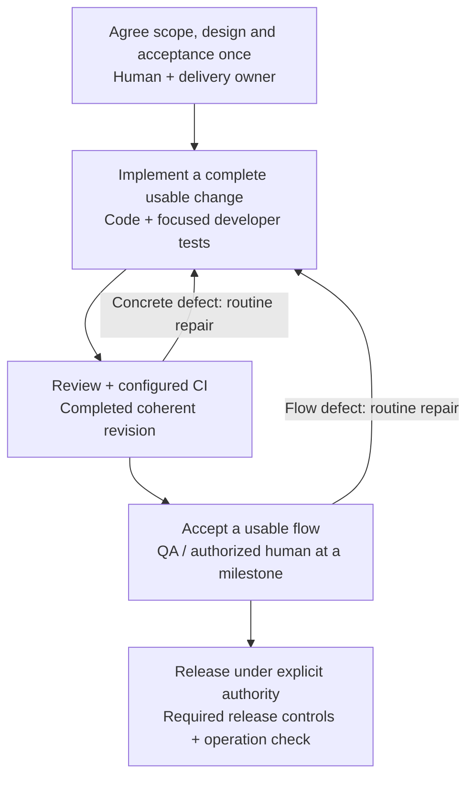
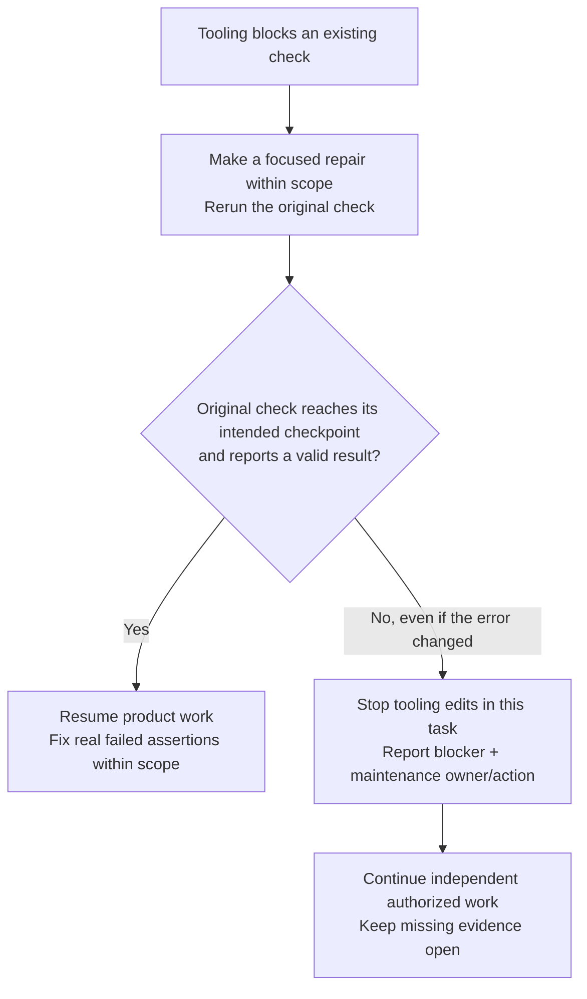

# Agent Kit

```text
    _   ___ ___ _  _ _____   _  _____ _____
   /_\ / __| __| \| |_   _| | |/ /_ _|_   _|
  / _ \ (_ | _|| .` | | |   | ' < | |  | |
 /_/ \_\___|___|_|\_| |_|   |_|\_\___| |_|

             CODEX + CLAUDE CODE
```

Shared project instructions, 17 technical skills and three optional native agents for Codex and Claude Code. One owner carries a coherent change through development and handoff. The kit does not choose your application stack.

**Version:** 0.1.0 preview. Package evidence is recorded in [verification results](docs/verification-results.md). Native discovery, effective model/permissions, workflow behavior and two-machine compatibility remain NOT_RUN unless a specific observation is recorded.

## How work flows

[Team workflow](docs/team-workflow.md) is the single delivery process:



One delivery owner carries the change through this flow. These are moments in delivery, not approval gates after every file. Developer tests are part of coding. Review evaluates a concrete completed change. QA/human acceptance checks usable flows at milestones. Routine repairs keep the existing approval and recheck only affected findings/checks; reuse unchanged evidence. Continue independent authorized work during review/CI waits, or hand off the waiting state without inventing work.

If tooling prevents a check from running, use this bounded recovery path:



The checkpoint is the original assertion or usable-flow check. A new error, input, agent or session does not reset the tooling limit. Further tooling work needs explicit maintenance scope; see [failure handling](docs/team-workflow.md#failures-and-blockers).

Pause only affected work for material missing decisions/expanded authority, incorrect or unsafe dependencies, or an action requiring release/real-data authority. Always honor human stops. See [policy](docs/team-policy.md) for permission/data boundaries.

## Quick start

1. Create one project repository from this template, or integrate its relevant parts into an existing codebase after review.
2. Open the root in Codex or Claude Code and give the actual task/outcome.
3. Agree scope, material choices and acceptance. Direct human approval covers its routine implementation/checks/repairs.
4. Name one delivery owner and use one task/issue. Shared project summaries are optional and have one assigned writer.
5. Deliver a usable coherent change, then review/CI and acceptance. Git writes and release require their actual scope.

### New project

```text
Use https://github.com/khiemnd777/agent-kit as the template for a new project.

Project name: [name]
Goal: [observable outcome]
Target users: [users]

Inspect the template. Propose scope, stack, ownership and acceptance in chat.
Wait for my approval before writing files or executing the setup.
After approval, initialize the project with fresh records and the single
team workflow. Establish a running app and basic check before broadening.
Do not import approvals from the template or build a comprehensive harness.
```

Replace bracketed inputs with project details.

### Existing codebase

```text
Use https://github.com/khiemnd777/agent-kit to integrate Agent Kit into this existing codebase.

Inspect current project instructions, skills, code and verified commands.
Preserve actual business rules, existing records and other developers' work.
Propose a bounded integration plan in chat and wait for my approval.
After approval, apply one delivery workflow and verify relevant package/
content consistency. Do not duplicate trackers or change global settings.
```

## Included sources

- [AGENTS.md](AGENTS.md) routes Codex; [CLAUDE.md](CLAUDE.md) imports the same instructions.
- [Team policy](docs/team-policy.md) defines authority and safety; [team workflow](docs/team-workflow.md) owns the delivery flow.
- [17 skills](docs/skills-catalog.md) provide selected technical guidance, mirrored byte for byte in `.claude/skills/`.
- [Task field guides](docs/agent-coordination-templates.md) support one record rather than a required document for each phase.
- [Role responsibilities](docs/roles/coordinator.md) support one owner and optional exploration/implementation/review delegation. No separate Coordinator or Supervisor is required.
- [TechNote](docs/technote.md) explains results and limits in the requested language.
- [Verification guide](docs/verification-guide.md), manifest and [compatibility notes](docs/agent-compatibility.md) distinguish source/package checks from native behavior.

## Project records

Use an existing issue/task tracker when available. Otherwise use [task records](docs/tasks/README.md) with authorized writes. [Context](docs/project-context.md), [plan](docs/project-plan.md) and [state](docs/project-state.md) are fresh optional shared summaries; keep one writer and link tasks instead of duplicating their checklists. They contain no inherited authority or completed product evidence.

For multiple developers, agree actual contracts and separate ownership. The assigning owner integrates results. Codex and Claude do not share live chat or locks; continuation uses the project record/source and the authorized team communication path.

## Runtime and delivery limits

[Model routing](docs/model-routing.md) inherits the developer's selection by default. Optional children retain parent/runtime and task limits; model selection adds no rights. Explorer/reviewer do not change application code, implement repairs or deploy, but their roles do not force sandbox/tool profiles. Disclose self-review if independent review did not run.

No application dependencies, credentials, hooks, automatic installers, services, global settings or test harness are bundled. TechNote presentation tools are separate capabilities. A completed source change is not verified runtime, human acceptance or release.

## Contributing and license

See [CONTRIBUTING.md](CONTRIBUTING.md) and [LICENSE](LICENSE). Sixteen engineering skills and selected references derive from the pinned [Addy Osmani source](https://github.com/addyosmani/agent-skills/tree/1401c8b8030e023baeebb31781a6653fe8e93026); approved adaptations retain origin metadata and the upstream MIT notice in [.agents/ADDY-AGENT-SKILLS-LICENSE](.agents/ADDY-AGENT-SKILLS-LICENSE) and its Claude mirror. See [catalog provenance](docs/skills-catalog.md#provenance) for current counts.
