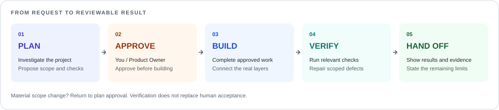

<div align="center">

# Agent Kit

### A clear workflow for AI-assisted development

Shared instructions, focused skills, and optional agents.<br>
Agree on the plan. Build the approved scope. Review the evidence.

**Field-tested across multiple SME projects.**


**Support:** [Claude · Codex · Gemini · Cursor · Grok](#support)

**[Quick start](#quick-start) · [How it works](#how-it-works) · [Review outputs](#see-what-youre-approving) · [What's included](#whats-included) · [Documentation](#documentation)**

</div>

---

**Agent Kit gives you and your coding assistant a shared way to work.** Use it as a template for a new project or integrate reviewed parts into an existing codebase. Keep your project's business rules, stack, contracts, and permissions.

Project-local instructions and adapters cover **Codex, Claude Code, Gemini CLI, and Cursor**. **Grok web/app** has a separate manual reference. These are source capabilities; see [status and limits](#status-and-limits) for runtime verification.

## Why Agent Kit?

- **See the scope and the result.** WHAT tables show planned work, completed items, and anything left undone.
- **See which skills contributed.** Skill tables name the guidance used, its source, and its actual contribution.
- **Resolve uncertainty before building.** Investigate the request, discuss material choices, and approve a concrete plan.
- **Review a clear handoff.** Inspect results, visuals, checks, and limits before deciding whether to accept the work.
- **Keep decisions available across sessions.** Maintain project context, plans, and one current-state summary.
- **Start with one owner.** Optional agents support bounded work when delegation is authorized and useful; a multi-agent team is not required.

## How it works



1. **Plan:** investigate the project and propose the outcome, scope, and relevant checks.
2. **Approve:** you or the Product Owner approve the plan before implementation, including small fixes.
3. **Build:** the owner completes the approved scope and real wiring.
4. **Verify:** run relevant checks and repair evidenced defects within scope.
5. **Hand off:** present the result, evidence, and limits for human review.

A short task can use a short chat plan. Approved scope does not need repeated approval per file; material scope changes require a revised plan. For roadmap delivery, the owner stops at each agreed acceptance package until you accept it and authorize the next.

For long, complex, or UI tasks, complete the approved production code and wiring before writing/updating tests and running them. Complex tasks first evaluate risks and alternatives; UI tasks first preview the proposed design for approval. See the [team workflow](docs/team-workflow.md).

## See what you're approving

Agent Kit makes the scope, reasoning, and delivery evidence visible in the conversation. You can review the plan before work starts and compare it with the final result.

*Illustrative example throughout: adding Copy buttons to the local README preview. The examples below show reporting formats, not evidence of a completed task.*

### WHAT — planned work and actual results

**Know what will change and what actually changed.** The owner shows the same items when presenting the plan and the completed work, including small tasks. Each table names the purpose, location, status, and reason for anything left undone.

**During planning**

| Name | Purpose | Location | Status | Reason if undone/ignored |
| --- | --- | --- | --- | --- |
| Copy controls | Copy each onboarding prompt | Local README preview | Proposed | Awaiting plan approval |

**At completion**

| Name | Purpose | Location | Status | Reason if undone/ignored |
| --- | --- | --- | --- | --- |
| Copy controls | Copy each onboarding prompt | Local README preview | Source complete | — |

The final table reports actual outcomes, including blocked or deferred work. A completed row does not by itself establish verified behavior, human acceptance, or release. See the [WHAT reporting rule](AGENTS.md#show-what-in-the-conversation).

### Skills — guidance and contribution

**See which skills shaped the work and how they helped.** Planning and completion reports list only skills actually applied, with compact source labels and concrete contributions.

| Skill | Source | Actual contribution | Estimated participation % |
| --- | --- | --- | --- |
| frontend-ui-engineering | Repo | Copy controls, keyboard access, and success/error feedback | 100% |

`Repo` means a skill in the target repository; `Personal` means an external personal, host, or plugin skill. `UNKNOWN` marks an unverified source. Participation percentages are subjective estimates totaling 100% across applied skills, not measured time, token savings, or effectiveness scores. If no skill was used, the owner says so. Authorized phase records retain the supporting details in the [local skill journal](docs/engineering/skill-usage/README.md).

### Planning, triage & discussion — decisions before implementation

**Turn a request or symptom into a plan you can approve.** Preparation follows the task: a small change needs a short discussion; complex work needs the relevant risks and alternatives resolved first.

1. **Triage:** inspect the request and relevant source; locate the affected area and distinguish facts from hypotheses. For a bug, compare actual and expected behavior before claiming a cause. In this example, the owner locates the existing prompt blocks and their preview renderer.
2. **Discuss:** separate confirmed requirements, proposals, and open questions. Resolve material choices with you. Here, agree that Copy targets the local preview and preserves each prompt's exact text; identify clipboard failure as a case to handle.
3. **Plan:** present the outcome, scope, delivery type, acceptance criteria, and relevant checks. Here, propose one handoff covering both buttons, clipboard contents, keyboard access, and success/error feedback. Wait for your or the Product Owner's approval before implementation.

**Make the proposed solution easy to picture.** For UI work, preview the layout, controls, and important states so the developer and reviewer can agree on how the result should work before coding. In this example, show where Copy appears, what it copies, and how success or failure is communicated.

Meaningful planning notes and decisions can be saved in the existing task record before plan approval, within the [planning-only documentation boundary](AGENTS.md#planning-only-documentation). Saved notes do not authorize implementation. See [planning](.agents/skills/planning-and-task-breakdown/SKILL.md), [source-led diagnosis](.agents/skills/debugging-and-error-recovery/SKILL.md), and [requirement discussion](.agents/skills/spec-driven-development/SKILL.md).

### Handoff & acceptance — a result you can review

**Receive a concise record of the result, its evidence, and the decision still needed.** Each handoff includes a revision, an actual result image or source-grounded diagram, an acceptance checklist, technical evidence, WHAT and Skills tables, and concrete next-step options.

**Make the delivered result easy to compare with the agreed solution.** Show the result alongside the accepted design and explain what matches, what changed, and what still needs review. For the Copy-controls example, demonstrate both buttons, provide the clipboard and keyboard checks, and identify any remaining limits.

The handoff brings the result, acceptance checklist, evidence, WHAT and Skills tables, and next actions together. The user or Product Owner then accepts the result, requests changes, or stops the work; the owner records that actual decision.

Source completion, verified behavior, human acceptance, and release are separate states. Record acceptance only after the actual human decision. Roadmap packages wait for acceptance and permission to open the next package; standalone work uses one handoff. See the [handoff and acceptance templates](docs/handoff-templates.md).

## Quick start

1. **Choose your starting point:** a new project or an existing codebase.
2. **Open the project root** in your coding client and use a prompt below. For Grok web/app, use the [manual attachment guide](docs/grok/README.md).
3. **Review and approve the proposed plan.** The template's history grants no approval for your project.
4. **Review the completed result and evidence** after the owner implements and checks the approved scope.

Replace bracketed inputs with your project details.

<details>
<summary><strong>Start a new project — copy this prompt</strong></summary>

```text
Create [project name] for [target users] to [goal] using https://github.com/khiemnd777/agent-kit.
Inspect the template, propose a plan, and wait for my approval before setup.
After approval, start with fresh project records and verify the app runs.
```

</details>

<details>
<summary><strong>Integrate into an existing codebase — copy this prompt</strong></summary>

```text
Integrate https://github.com/khiemnd777/agent-kit into this codebase.
Inspect the project and propose a minimal plan. Preserve existing rules, stack, records, and current work.
Wait for my approval, then apply the plan and verify the integration.
```

</details>

## What's included

| Component | What it helps you do | Start here |
| --- | --- | --- |
| **Shared instructions** | Establish the planning, approval, implementation, and handoff rules. | [AGENTS.md](AGENTS.md) |
| **17 technical skills** | Apply focused guidance to the task at hand. Claude skills mirror the canonical sources byte for byte. | [Skill catalog](docs/skills-catalog.md) |
| **Three optional roles** | Assign bounded exploration, implementation, or review through client-specific adapters. | [Roles and model routing](docs/model-routing.md) |
| **Project records** | Keep context, plans, state, and task evidence available across sessions. | [Task and record guide](docs/tasks/README.md) |
| **TechNote** | Explain results through text, diagrams, interactive websites, or video, when tools are available. | [Explanation method](docs/technote.md) |
| **Grok manual reference** | Prepare a local reference for an authorized manual chat attachment. | [Grok guide](docs/grok/README.md) |

## Support

| Client | Project entry point | Source setup |
| --- | --- | --- |
| Claude (Claude Code) | [CLAUDE.md](CLAUDE.md) imports the shared instructions | Claude skill mirror and optional `.claude/agents/`. |
| Codex | [AGENTS.md](AGENTS.md) | Canonical `.agents/skills/`; optional `.codex/agents/`. |
| Gemini (Gemini CLI) | [GEMINI.md](GEMINI.md) imports the shared instructions | Canonical skills and optional `.gemini/agents/`. |
| Cursor | Root `AGENTS.md` | Canonical skills and optional `.cursor/agents/`; duplicate skill discovery remains unverified. |
| Grok (web/app) | [Manual guide and bootstrap](docs/grok/README.md) | Local export for manual attachment; no native repository discovery or local execution claimed. |

Keep `AGENTS.md` and `.agents/` as the shared sources, and retain the Claude mirror. Integrate only reviewed project-local files under an approved adoption plan. No client installation, account configuration, or content upload is automatic. See the [capability and discovery matrix](docs/agent-compatibility.md).

## Documentation

| I want to… | Read |
| --- | --- |
| Understand delivery and handle blocked checks | [Team workflow](docs/team-workflow.md) · [Failure handling](docs/team-workflow.md#failures-and-blockers) |
| Understand approval and safety boundaries | [Team policy](docs/team-policy.md) |
| Keep project knowledge available | [Context](docs/project-context.md) · [Plan](docs/project-plan.md) · [Current state](docs/project-state.md) |
| Coordinate bounded assignments | [Task field guides](docs/agent-coordination-templates.md) · [Owner responsibilities](docs/roles/coordinator.md) |
| Record actual skill contributions | [Local skill journal](docs/engineering/skill-usage/README.md) |
| Check compatibility and package evidence | [Compatibility](docs/agent-compatibility.md) · [Verification guide](docs/verification-guide.md) · [Recorded results](docs/verification-results.md) |

Keep durable rules in `AGENTS.md`, stable design in project context, intended outcomes in project plan, and one live summary in project state. Assign one writer to shared records. Clients do not share live chat or locks; continue through source, project records, and the authorized communication path.

## Status and limits

**Version 1.0.0.** See the [verification guide](docs/verification-guide.md) and [recorded results](docs/verification-results.md) for package checks and client observations.

- Models inherit the developer's selection by default. Role descriptions do not enforce sandbox or tool permissions; see [model routing](docs/model-routing.md).
- No application dependencies, credentials, hooks, automatic installers, services, global settings, or test harness are bundled. Python is a maintenance prerequisite for the local Grok export and package checks, not a client runtime dependency. TechNote presentation tools are separate capabilities.
- Source completion, verified behavior, human acceptance, and release are distinct. Git publication, deployment, production/data operations, paid actions, and destructive actions require their actual authority.

## Contributing and license

See [CONTRIBUTING.md](CONTRIBUTING.md) and the [MIT license](LICENSE).

Sixteen engineering skills and selected references derive from the pinned [Addy Osmani source](https://github.com/addyosmani/agent-skills/tree/1401c8b8030e023baeebb31781a6653fe8e93026). Approved adaptations retain origin metadata and the upstream MIT notice in [.agents/ADDY-AGENT-SKILLS-LICENSE](.agents/ADDY-AGENT-SKILLS-LICENSE) and its Claude mirror. See [skill provenance](docs/skills-provenance.md) for current counts.
