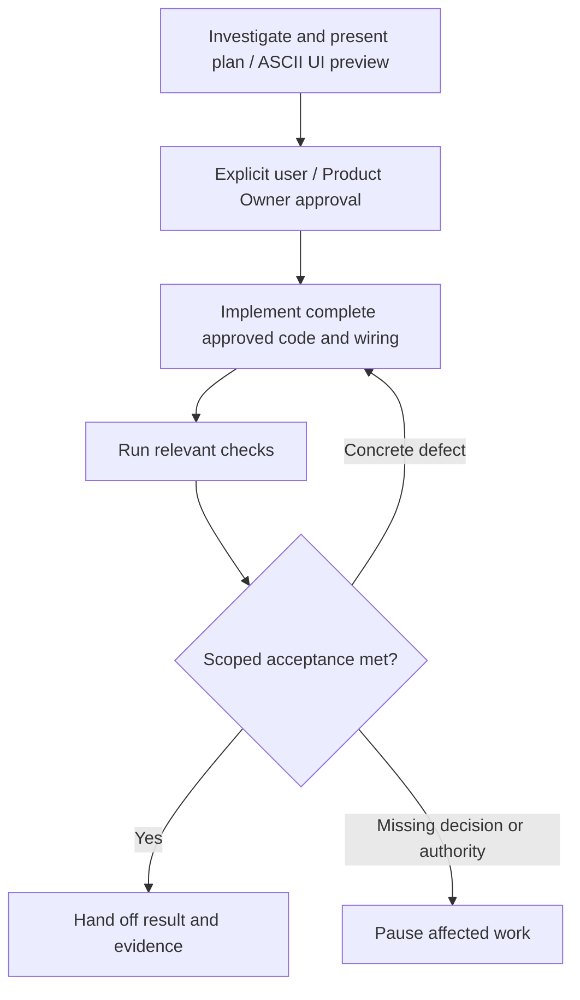

# Agent Kit

```text
    _   ___ ___ _  _ _____   _  _____ _____
   /_\ / __| __| \| |_   _| | |/ /_ _|_   _|
  / _ \ (_ | _|| .` | | |   | ' < | |  | |
 /_/ \_\___|___|_|\_| |_|   |_|\_\___| |_|

             CODEX + CLAUDE CODE
```

Shared project instructions, 17 technical skills and three optional native agents for Codex and Claude Code. One owner carries a coherent change through development and handoff. The kit does not choose your application stack.

**Version:** 0.1.0 preview. Package evidence is recorded in [verification results](docs/verification-results.md). Native discovery, effective model/permissions, workflow behavior and two-machine compatibility remain NOT_RUN unless a specific observation is recorded.

## How work flows

[AGENTS.md](AGENTS.md) is the lean operating core. Consult [workflow detail](docs/team-workflow.md), policy or a skill only when the current task needs it.



The main session owns delivery by default. Every task, including a focused fix, requires planning and explicit approval before implementation; a short chat plan is sufficient for small work and needs no new task file or extra agent. Long/complex/UI tasks complete all approved code before writing/updating and running tests. Complex tasks first evaluate risks/alternatives; UI tasks first preview an ASCII mockup. A feature needs complete callers and relevant regression coverage. Sensitive work retains its actual security, data and project review controls. These are effort choices within one workflow, based on risk rather than file count or duration.

Keep durable rules separate from stable context, planned outcomes and the single current-state summary. Update affected state/task entries proactively within authorized writes; use one concise checkpoint for a real interruption/handoff and reuse unaffected evidence. Select minimum sufficient skills during planning; report actual phase contributions, source and estimates from the [authorized local journal](docs/engineering/skill-usage/README.md). Finish when scoped acceptance and appropriate checks are satisfied. Optional polish, unrelated refactors and broader audits do not extend the task automatically. Human acceptance and release require their actual evidence and authority.

## When a check is blocked

Diagnose whether the check reached its intended assertion or was blocked by tooling. Repair a supported cause within scope and rerun the affected check. Continue while new evidence and useful progress justify the cost; a new error alone is not progress. If attempts stop helping, change strategy or hand off the concrete blocker. There is no one-repair cutoff or unlimited retry permission.

Do not build a runner/review system incidentally or fill waiting time with unrelated checks. Continue independent authorized work; keep missing required proof open. See [failure handling](docs/team-workflow.md#failures-and-blockers) and the [Codex pilot handoff](docs/codex-pilot-handoff.md). The pilot remains NOT_RUN.

## Quick start

1. Create one project repository from this template, or integrate its relevant parts into an existing codebase after review.
2. Open the root in Codex or Claude Code and give the actual task/outcome.
3. Present a plan and obtain explicit approval before implementation, including small fixes; approved scope covers local edits, focused checks and routine repairs.
4. The main session owns delivery by default; use a tracker/checkpoint only when helpful or required. Shared records have one writer when edited.
5. Deliver a usable coherent change with relevant checks and project-required review/CI, then hand off. Human acceptance is performed when included in the task; Git writes and release require their actual scope.

### New project

```text
Use https://github.com/khiemnd777/agent-kit as the template for a new project.

Project name: [name]
Goal: [observable outcome]
Target users: [users]

Inspect the template. Propose scope, stack, ownership and acceptance in chat.
Wait for my approval before writing files or executing the setup.
After approval, initialize the project with fresh records and the single
team workflow. Establish a running app and basic check before broadening.
Do not import approvals from the template or build a comprehensive harness.
```

Replace bracketed inputs with project details.

### Existing codebase

```text
Use https://github.com/khiemnd777/agent-kit to integrate Agent Kit into this existing codebase.

Inspect current project instructions, skills, code and verified commands.
Preserve actual business rules, existing records and other developers' work.
Propose a bounded integration plan in chat and wait for my approval.
After approval, apply one delivery workflow and verify relevant package/
content consistency. Do not duplicate trackers or change global settings.
```

## Included sources

- [AGENTS.md](AGENTS.md) routes Codex; [CLAUDE.md](CLAUDE.md) imports the same instructions.
- [Team policy](docs/team-policy.md) defines authority and safety; [team workflow](docs/team-workflow.md) owns the delivery flow.
- [17 skills](docs/skills-catalog.md) provide selected technical guidance, mirrored byte for byte in `.claude/skills/`.
- [Task field guides](docs/agent-coordination-templates.md) support one record rather than a required document for each phase.
- [Role responsibilities](docs/roles/coordinator.md) support one owner and optional exploration/implementation/review delegation. No separate Coordinator or Supervisor is required.
- [TechNote](docs/technote.md) explains results and limits in the requested language.
- [Verification guide](docs/verification-guide.md), manifest and [compatibility notes](docs/agent-compatibility.md) distinguish source/package checks from native behavior.

## Project records

Use a project tracker when required or useful; [checkpoints](docs/tasks/README.md) are optional for focused fixes and valuable for long/resumed tasks. [Context](docs/project-context.md), [plan](docs/project-plan.md) and [state](docs/project-state.md) are fresh optional shared summaries; keep one writer and link tasks instead of duplicating their checklists. They contain no inherited authority or completed product evidence.

For multiple developers, agree actual contracts and separate ownership. The assigning owner integrates results. Codex and Claude do not share live chat or locks; continuation uses the project record/source and the authorized team communication path.

## Runtime and delivery limits

[Model routing](docs/model-routing.md) inherits the developer's selection by default. Optional children retain parent/runtime and task limits; model selection adds no rights. Explorer/reviewer do not change application code, implement repairs or deploy, but their roles do not force sandbox/tool profiles. Disclose self-review if independent review did not run.

No application dependencies, credentials, hooks, automatic installers, services, global settings or test harness are bundled. TechNote presentation tools are separate capabilities. A completed source change is not verified runtime, human acceptance or release.

## Contributing and license

See [CONTRIBUTING.md](CONTRIBUTING.md) and [LICENSE](LICENSE). Sixteen engineering skills and selected references derive from the pinned [Addy Osmani source](https://github.com/addyosmani/agent-skills/tree/1401c8b8030e023baeebb31781a6653fe8e93026); approved adaptations retain origin metadata and the upstream MIT notice in [.agents/ADDY-AGENT-SKILLS-LICENSE](.agents/ADDY-AGENT-SKILLS-LICENSE) and its Claude mirror. See [skill provenance](docs/skills-provenance.md) for current counts.
